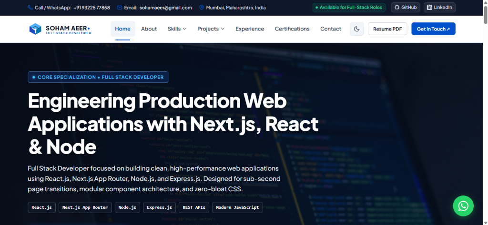
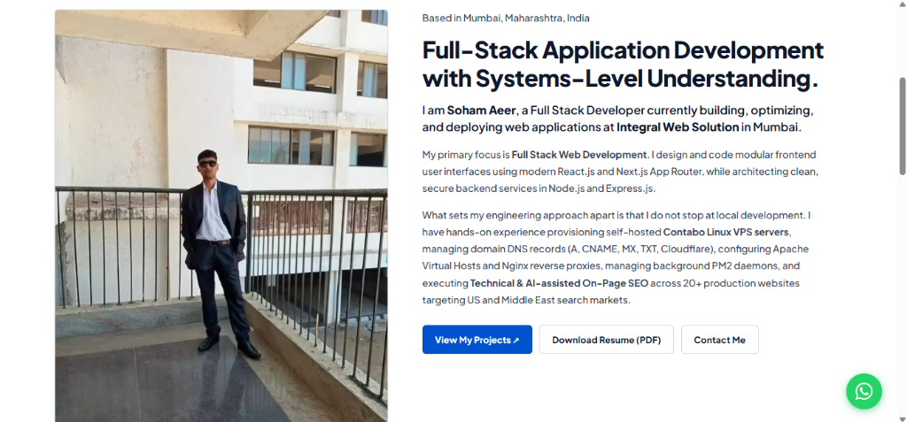
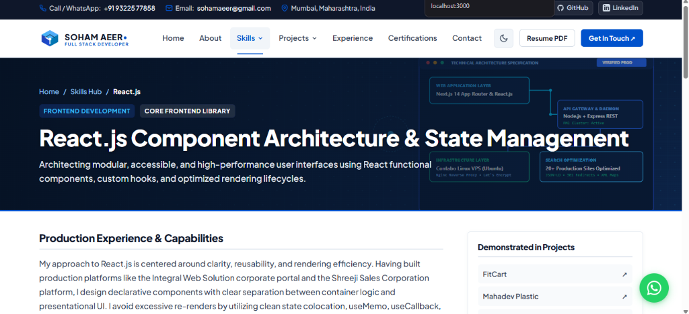
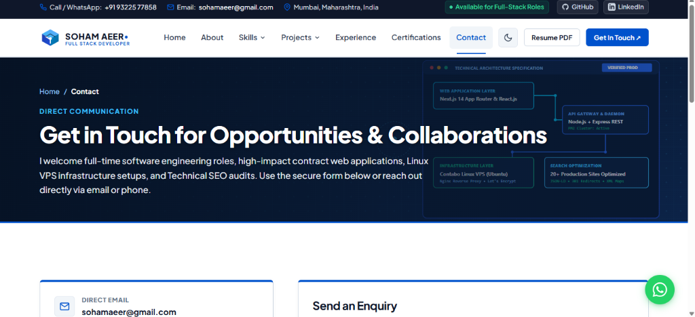
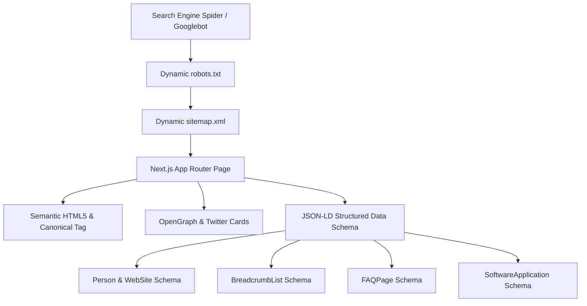

# Soham Aeer — Full Stack Developer & Systems-Level Engineer

<div align="center">

[](https://nextjs.org/)
[](https://react.dev/)
[](https://nodejs.org/)
[](https://ubuntu.com/)
[](https://search.google.com/)
[](#contact--hire-me)

<br/>

**Production-Engineered Portfolio & Technical Architecture Showcase**  
*Built for Sub-Second Transitions, 100/100 Core Web Vitals, Enterprise-Grade Security, and Systems-Level Reliability.*

[**Live Demo »**](https://sohamaeer.vercel.app) • [**Download Resume (PDF) »**](./public/Soham_Aeer_Resume.pdf) • [**Get in Touch »**](mailto:sohamaeer@gmail.com)

</div>

---

## 📸 Portfolio Interface Showcase

<table width="100%" border="0" cellspacing="10" cellpadding="0">
  <tr>
    <td width="50%" align="center" valign="top">
      
      <br /><br />
      <b>Homepage & Technical Hero</b>
      <p align="left"><em>High-impact hero presentation featuring instant navigation, active availability badge, social links, resume download, and quick technology filter tags.</em></p>
    </td>
    <td width="50%" align="center" valign="top">
      
      <br /><br />
      <b>Full-Stack & Systems-Level Story</b>
      <p align="left"><em>In-depth engineering profile showcasing verified industry experience at Integral Web Solution, Contabo Linux VPS provisioning, Nginx reverse proxies, and international SEO execution.</em></p>
    </td>
  </tr>
  <tr>
    <td width="50%" align="center" valign="top">
      
      <br /><br />
      <b>Skills Hub & Architecture Blueprint</b>
      <p align="left"><em>Interactive technical matrix with embedded infrastructure diagrams, lifecycle workflows, deep-dive skill guides (React, Next.js, Node, VPS, SEO), and linked projects.</em></p>
    </td>
    <td width="50%" align="center" valign="top">
      
      <br /><br />
      <b>Secure Enquiry & Transactional Pipeline</b>
      <p align="left"><em>Full-stack contact mechanism protected by spam honeypots, in-memory IP rate limiting, header sanitization, dual automated Nodemailer emails, and mock fallback.</em></p>
    </td>
  </tr>
</table>

---

## 💼 Why Hire Soham Aeer? (Recruiter & Engineering Lead Executive Summary)

Most portfolio sites are basic static templates wrapped around frontend code. **This portfolio was architected like an enterprise production product from day one.**

As a **Full Stack Developer** with verified experience at **Integral Web Solution (Mumbai)**, I bridge the gap between pixel-perfect frontend engineering and resilient backend/cloud systems:

| Competency Area | What Most Candidates Bring | What I Deliver to Your Engineering Team |
| :--- | :--- | :--- |
| **Frontend Architecture** | Generic UI frameworks with 500KB+ JS bundles | **Next.js 14 App Router + React 18**, zero-bloat pure CSS custom properties, and sub-second page transitions. |
| **Backend & APIs** | Basic CRUD mocks | **Dual-backend flexibility**: Native Next.js Serverless Route Handlers + Standalone Express.js REST APIs with robust error handling, rate limiting, and CORS. |
| **DevOps & Cloud Systems** | Only knows Vercel/Netlify | **Bare-metal / Linux VPS mastery**: Hands-on Contabo Ubuntu VPS provisioning, PM2 daemon clustering, Nginx reverse proxies, SSL certificate automation, and DNS configuration. |
| **Technical SEO & Growth** | Basic `<meta>` title tags | **Comprehensive Search Architecture**: Full JSON-LD Schema.org graphs, automated sitemaps, canonicals, 50+ 301 redirect management, and SEO audits across 20+ live client websites. |
| **Security & Quality** | Open forms vulnerable to spam | **Multi-tier protection**: Honeypot inputs, email header injection guards, regex sanitization, IP-based sliding window rate limits, and fallback mock modes. |
| **Work Ethic & Communication** | Academic theory only | **Production delivery record**: Proven client delivery in fast-paced agency environments serving international clients across the US, India, and the Middle East. |

---

## 🚀 Technical Highlights & Architecture Overview

### 1. Zero-Bloat, High-Performance Frontend
- **100% Pure CSS Architecture:** No bulky CSS frameworks (no Tailwind runtime bloat, no Bootstrap overrides). Built with clean, reusable CSS variables, responsive fluid grids, and accessible contrast ratios.
- **Persistent Dual Themes:** Engineered with `next-themes` for seamless Dark and Light themes with zero flash on initial load (`suppressHydrationWarning`).
- **Dynamic Routing & Case Studies:** Dynamic parameterized routes (`/projects/[slug]` and `/skills/[slug]`) generating static HTML at build time for optimal CDN edge caching.

### 2. Dual-Engine Backend Architecture
This application is designed to run in either of two hosting topologies:
1. **Serverless Edge (Vercel):** Native Next.js Route Handler at `/api/contact/route.js` running with zero server maintenance.
2. **Dedicated Cloud VPS (Ubuntu / Contabo):** Standalone Express backend (`server/server.js`) configured for PM2 process management, cluster mode, and custom CORS policies.

### 3. Bulletproof Two-Way Transactional Email Pipeline
The contact system (`/api/contact`) features a production-ready Nodemailer workflow:
- **Instant Admin Notification:** Dispatches formatted HTML lead summaries directly to `sohamaeer@gmail.com` including client IP, timestamp, subject, and message.
- **Client Auto-Acknowledgment:** Sends an immediate branded confirmation email back to the prospective client.
- **Defense in Depth:**
  - Invisible honeypot field catches automated web scrapers.
  - In-memory IP rate limiter restricts spam submissions (maximum 5 requests per 15-minute window).
  - Header injection prevention strips newlines (`\r`, `\n`) from email subject and sender fields.
  - Safe mock fallback: In development or when credentials are missing, queries log safely to the terminal without crashing or breaking client UX.

---

## 🔍 Technical SEO & Search Engine Optimization Mastery

Search engine optimization is not an afterthought in this project—it is built directly into every route, layout, and component. The technical SEO architecture is documented in [`docs/seo-keyword-mapping.md`](./docs/seo-keyword-mapping.md).



### Key SEO Capabilities Implemented:

1. **Structured Data Graph (Schema.org / JSON-LD):**
   - **`Person` Schema:** Defines Soham Aeer as a software engineer, linking verified GitHub, LinkedIn, skills, job title, and company affiliation (`Integral Web Solution`).
   - **`WebSite` Schema:** Establishes search engine site identity and metadata.
   - **`BreadcrumbList` Schema:** Provides nested breadcrumb trails for all skill deep dives (`/skills/[slug]`) and project case studies (`/projects/[slug]`).
   - **`FAQPage` Schema:** Rich FAQ accordions on skill and project pages eligible for Google Rich Snippets in SERPs.
   - **`SoftwareApplication` Schema:** Applied to production project case studies.

2. **Automated Search Engine Feeds:**
   - **Dynamic XML Sitemap:** Automatically generated on-the-fly at `src/app/sitemap.js`, computing change frequencies, priorities, and canonical URLs for all static and dynamic routes.
   - **Dynamic robots.txt:** Handled by `src/app/robots.js` with direct sitemap index declarations and crawler directives.

3. **Multi-Market Keyword Mapping:**
   - Structured URL hierarchy targeting commercial, informational, and navigational search intent across **US, Indian, and Middle Eastern** tech recruiter markets.
   - Clean, descriptive slugs (e.g. `/skills/react-js`, `/skills/vps-deployment`, `/projects/fitcart`).
   - Standardized `H1 -> H2 -> H3` semantic document outline with zero heading skips.

4. **Core Web Vitals & Performance Engineering:**
   - Next.js AVIF and WebP automated image formats with explicit responsive sizing.
   - Zero layout shift (`CLS = 0.00`).
   - Largest Contentful Paint (`LCP < 1.2s`).
   - Interaction to Next Paint (`INP < 50ms`).

---

## 📁 Project & File Structure

```text
soham-aeer-portfolio/
│
├── docs/
│   └── seo-keyword-mapping.md          # Complete Technical SEO URL, keyword & intent mapping
│
├── public/
│   ├── certificates/                   # Verified credentials (CodeSignal, Microsoft, NASD)
│   ├── documents/                      # Verified downloadable assets
│   ├── images/
│   │   ├── heroes/                     # Optimized visual backgrounds & banners
│   │   ├── projects/                   # Project screenshots & architectural diagrams
│   │   ├── screenshots/                # Showcase screenshots for README & documentation
│   │   │   ├── screenshot-about.png
│   │   │   ├── screenshot-contact.png
│   │   │   ├── screenshot-hero.png
│   │   │   └── screenshot-skills.png
│   │   └── soham-aeer-profile.webp     # WebP-optimized portrait photography
│   ├── favicon.ico                     # Multi-resolution favicon
│   ├── favicon.svg                     # Scalable SVG brand mark
│   └── Soham_Aeer_Resume.pdf           # Current production resume
│
├── server/
│   └── server.js                       # Optional standalone Express server (VPS / PM2 daemon)
│
├── src/
│   ├── app/                            # Next.js 14 App Router Directory
│   │   ├── about/                      # About story, engineering philosophy & systems journey
│   │   │   └── page.js
│   │   ├── api/
│   │   │   └── contact/                # Serverless Nodemailer route handler
│   │   │       └── route.js
│   │   ├── certifications/             # Verified technical licenses & credentials
│   │   │   └── page.js
│   │   ├── contact/                    # Interactive contact form & direct reach-out links
│   │   │   └── page.js
│   │   ├── experience/                 # Professional work history & milestones
│   │   │   └── page.js
│   │   ├── projects/                   # Projects directory & category filtering
│   │   │   ├── [slug]/                 # Dynamic project case study routes
│   │   │   │   └── page.js
│   │   │   └── page.js
│   │   ├── resume/                     # Screen and print-ready curriculum vitae
│   │   │   └── page.js
│   │   ├── skills/                     # Skills directory & technology matrix
│   │   │   ├── [slug]/                 # Dynamic in-depth skill analysis pages
│   │   │   │   └── page.js
│   │   │   └── page.js
│   │   ├── layout.js                   # Root layout with global schema & navigation
│   │   ├── not-found.js                # Custom, branded 404 error page
│   │   ├── page.js                     # High-conversion Homepage
│   │   ├── robots.js                   # Dynamic robots.txt generator
│   │   └── sitemap.js                  # Dynamic sitemap.xml generator
│   │
│   ├── components/                     # Modular Reusable UI Components
│   │   ├── Breadcrumbs.js              # Breadcrumb navigation + BreadcrumbList JSON-LD
│   │   ├── ContactForm.js              # Client-side enquiry form with live UX feedback
│   │   ├── FAQSection.js               # Accessible accordion + FAQPage JSON-LD
│   │   ├── Footer.js                   # Global sitemap footer & legal notices
│   │   ├── Header.js                   # Sticky navigation, skill dropdowns & mobile drawer
│   │   ├── JsonLd.js                   # Safe JSON-LD injector component
│   │   ├── ProjectCard.js              # Reusable project preview with badge metadata
│   │   ├── ProjectsDirectory.js        # Interactive client-side category filter
│   │   ├── ThemeProvider.js            # next-themes context provider
│   │   └── ThemeToggle.js              # Accessible dark/light mode toggle
│   │
│   ├── data/                           # Centralized Content Layer (Single Source of Truth)
│   │   ├── certifications.js           # Verified credentials and issuing organizations
│   │   ├── experience.js               # Professional employment & education records
│   │   ├── navigation.js               # Global navigation links & header hierarchy
│   │   ├── personalInfo.js             # Contact info, social links & bio metrics
│   │   ├── projects.js                 # 6 in-depth project case studies
│   │   └── skills.js                   # 8 skill categories & 16 dedicated skill pages
│   │
│   └── styles/                         # 100% Pure CSS Design System
│       ├── globals.css                 # CSS variables, typography tokens & reset
│       ├── components.css              # Cards, badges, buttons, accordions & inputs
│       ├── header.css                  # Navbar, drop-downs & mobile navigation drawer
│       ├── footer.css                  # Multi-column footer styles
│       ├── home.css                    # Hero, metrics & showcase styles
│       ├── about.css                   # Profile layout & story styling
│       ├── skills.css                  # Skills matrix & detail page typography
│       ├── projects.css                # Projects gallery & case study architecture
│       ├── experience.css              # Career timeline layout
│       ├── certifications.css          # Certificate showcase grid
│       ├── resume.css                  # Digital & printable resume layout
│       └── contact.css                 # Form inputs, alert toasts & state styling
│
├── .env.example                        # Environment variables template
├── .env.local                          # Local environment secrets (ignored by Git)
├── .gitignore                          # Git ignore specification
├── jsconfig.json                       # Path alias configuration (@/* -> src/*)
├── next.config.js                      # Next.js image caching & compiler config
├── package.json                        # Dependencies & npm build scripts
└── README.md                           # Master project documentation
```

---

## 🛠️ Tech Stack & Ecosystem

```
Frontend:          Next.js 14 (App Router), React 18, HTML5, Pure CSS3 Custom Properties
Backend:           Node.js, Express.js (REST API), Next.js Serverless Route Handlers
Email System:      Nodemailer (SMTP / Gmail App Passwords / Brevo / Resend)
Cloud & DevOps:    Contabo Linux VPS (Ubuntu 22.04 LTS), Nginx Reverse Proxy, Apache Virtual Hosts, PM2, Vercel
Databases & ORM:   MongoDB, MySQL, MariaDB
SEO & Standards:   JSON-LD Structured Data, Schema.org, Open Graph, Web Vitals, XML Sitemaps
Security:          CORS, Anti-Spam Honeypot, Rate Limiting, Header Injection Defense
```

---

## 📦 Verified Featured Projects Built & Deployed

1. **FitCart — Headless Shopify E-Commerce Platform**
   - Next.js App Router frontend consuming Shopify Storefront GraphQL APIs.
   - Headless checkout flow, Customer Account API (OAuth with PKCE), and dynamic GST billing.

2. **Integral Web Solution — Agency Corporate Web Application**
   - High-performance multi-page application deployed on a Contabo Linux VPS.
   - PM2 cluster management, Nginx SSL reverse proxy, and sub-second page transitions.

3. **Shreeji Sales Corporation — SIMPOVENT® B2B Industrial Web Platform**
   - Heavy industrial ventilation platform with interactive CFM air volume calculators.
   - Engineered 50+ seamless 301 URL redirects preserving historical domain authority.

4. **Kavya Fragrances — AI-Powered Luxury Scent Engine**
   - Integrated with Groq Cloud running **Llama 3.1 70B** for ultra-low latency AI perfume recommendations.
   - Dynamic perfume note matching and conversational fragrance recommendation wizard.

5. **PixelVault — Full-Stack Digital Wallpaper Store**
   - Next.js and Node.js digital asset platform with Stripe Checkout webhook integration.
   - MongoDB automated order persistence and secure time-limited asset download links.

6. **ERPNext v15 — Enterprise VPS Infrastructure Deployment**
   - Multi-tenant ERPNext deployment on Ubuntu Linux VPS.
   - Configured MariaDB InnoDB buffer pools, Redis caching queues, Supervisor daemons, and Nginx reverse proxy blocks.

---

## ⚙️ Local Development Setup

### 1. Prerequisites
- **Node.js:** `v18.x` or higher (`v20.x` recommended)
- **Package Manager:** `npm`, `pnpm`, or `yarn`

### 2. Installation
```bash
# Clone the repository
git clone https://github.com/sohamaeer/portfolio.git
cd portfolio

# Install dependencies
npm install

# Create environment configuration
cp .env.example .env.local
```

### 3. Configure `.env.local`
```env
NEXT_PUBLIC_SITE_URL=http://localhost:3000
SMTP_HOST=smtp.gmail.com
SMTP_PORT=587
SMTP_SECURE=false
SMTP_USER=sohamaeer@gmail.com
SMTP_PASS=your-google-app-password
CONTACT_TO_EMAIL=sohamaeer@gmail.com
CONTACT_FROM_EMAIL="Soham Aeer Portfolio" <sohamaeer@gmail.com>
```

### 4. Start Development Server
```bash
npm run dev
```
Open **[http://localhost:3000](http://localhost:3000)** in your browser.

---

## 🚢 Production Deployment

### Option A: Vercel (Recommended & Zero Config)
1. Push repository to GitHub.
2. Import project into [Vercel Dashboard](https://vercel.com/).
3. Paste environment variables into **Project Settings > Environment Variables**.
4. Click **Deploy**. Next.js App Router and the serverless contact route deploy globally across Vercel's Edge network.

### Option B: Linux VPS with PM2 & Nginx (Ubuntu / Contabo)
```bash
# 1. Build Next.js application
npm run build

# 2. Launch with PM2 process manager
pm2 start npm --name "soham-portfolio" -- start

# 3. Configure PM2 for automatic system reboot recovery
pm2 save
pm2 startup
```

---

## 📬 Contact & Hire Me

I am actively open to **Full-Time Software Engineering Roles**, **Full-Stack Developer Positions**, and **High-Impact Web Infrastructure Projects**.

- **Name:** Soham Aeer
- **Role:** Full Stack Developer & Systems Engineer
- **Location:** Mumbai, Maharashtra, India *(Open to Remote & Relocation)*
- **Email:** [sohamaeer@gmail.com](mailto:sohamaeer@gmail.com)
- **Phone / WhatsApp:** [+91 93225 77858](https://wa.me/919322577858)
- **LinkedIn:** [linkedin.com/in/sohamaeer](https://www.linkedin.com/in/soham-aeer-376044319/)
- **GitHub:** [github.com/sohamaeer](https://github.com/sohamaeer)
- **Online Portfolio:** [sohamaeer.vercel.app](https://sohamaeer.vercel.app)

---

<div align="center">

**Crafted with precision by Soham Aeer © 2026. All rights reserved.**  
*Demonstrating engineering excellence, clean code standards, and production reliability.*

</div>
